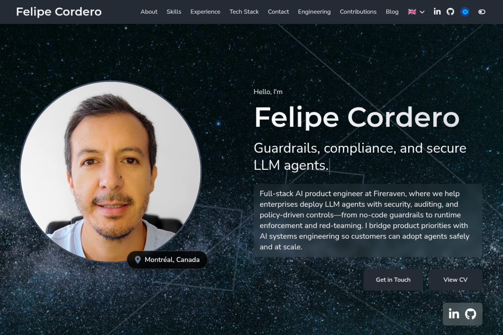

# CareerCanvas Hugo Theme

A responsive Hugo theme for personal portfolios (Felipe Cordero). Dark mode, Tailwind CSS, configurable colors, portfolio galleries, blog, skills, experience timeline, contact, multilingual (EN/FR).

## Easiest way to run this theme

Use the **[Portfolio repo (Felipe Cordero)](https://github.com/felipecordero/felipecordero.github.io)** and follow its [README](https://github.com/felipecordero/felipecordero.github.io#readme) for setup, dev server (`npm run dev`), and production build.

## Demo

[felipecordero.com](https://felipecordero.com)



## Installation

**Submodule (recommended):**
```bash
git submodule add https://github.com/felipecordero/careercanvas.git themes/careercanvas
```

**Clone:**
```bash
git clone https://github.com/felipecordero/careercanvas.git themes/careercanvas
```

## Configuration

Set `theme = "careercanvas"` and add `[params]` (name, tagline, profile_image, social links, resume URLs, etc.). See `example-config.toml` in this repo for a full example.

**Experience (multi-role companies):** In `content/*/experience.md`, each `positions` entry is one company. For promotions or multiple titles at the same employer, use optional `roles` (keep company-level `period` as overall tenure). Legacy single-role entries still work with top-level `role`, `period`, and `bullet_points`.

```yaml
positions:
  - company: "Acme"
    company_url: "https://example.com"
    period: "May 2025 - Present"
    industry: "Software"
    location: "City"
    company_description: "What the company does."
    roles:
      - title: "Head of Technology"
        period: "Sept 2026 - Present"
        bullet_points:
          - "Current role achievement."
      - title: "Full-Stack Engineer"
        period: "May 2025 - Sept 2026"
        bullet_points:
          - "Earlier role achievement."
```

**Colors:** See [COLOR_CUSTOMIZATION.md](COLOR_CUSTOMIZATION.md).

**Gallery shortcode:** ``

## License

MIT — see [LICENSE](LICENSE). Issues and contact: [GitHub](https://github.com/felipecordero/careercanvas) / [felipecordero.com](https://felipecordero.com).
