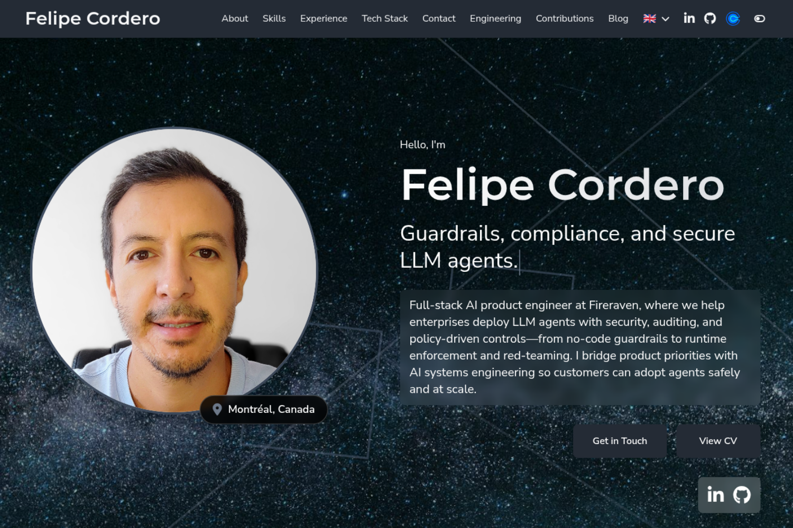

# CareerCanvas Hugo Theme

A responsive Hugo theme for personal portfolios (Felipe Cordero). Dark mode, Tailwind CSS, configurable colors, portfolio galleries, blog, skills, experience timeline, contact, multilingual (EN/FR).

## Easiest way to run this theme

Use the **[Portfolio repo (Felipe Cordero)](https://github.com/felipecordero/felipecordero.github.io)** and follow its [README](https://github.com/felipecordero/felipecordero.github.io#readme) for setup, dev server (`npm run dev`), and production build.

## Demo

[felipecordero.com](https://felipecordero.com)



## Installation

**Submodule (recommended):**
```bash
git submodule add https://github.com/felipecordero/careercanvas.git themes/careercanvas
```

**Clone:**
```bash
git clone https://github.com/felipecordero/careercanvas.git themes/careercanvas
```

## Configuration

Set `theme = "careercanvas"` and add `[params]` (name, tagline, profile_image, social links, etc.). See `example-config.toml` in this repo for a full example.

### Resume links

Define each resume URL once, in its language configuration:

```toml
[languages.en.params]
  resume_url = "/files/your-cv-en.pdf"
[languages.fr.params]
  resume_url = "/files/your-cv-fr.pdf"
```

In the front matter of each `content/LANGUAGE/experience.md`, select the resumes
and their display order:

```yaml
resume_downloads:
  - lang: en
    label: EN
  - lang: fr
    label: FR
```

The shared `resume-links.html` partial accepts a Hugo Site and returns ordered
`{lang, label, url}` dictionaries. Experience, the hero, and the 404 page all use
this selection. Hero and 404 append language labels when more than one resume
is selected. An omitted label defaults to the uppercase language code.

Only active site languages with a non-empty `params.resume_url` are included.
Unknown/disabled languages and missing URLs are skipped. If there is no
experience page or no `resume_downloads` selection (including an empty list),
no resume buttons are rendered anywhere.

**Migration:** move legacy global `params.resume_url`, `params.resume_url_en`,
and `params.resume_url_fr` values to the corresponding language's
`params.resume_url`. Remove `params.resume_label`; button text comes from i18n
and `resume_downloads[].label`. Ensure each language's experience page contains
its intended selection. The suffixed legacy keys are no longer read. Remove the
global `params.resume_url` too: Hugo inherits global params into language params,
so leaving it set can unintentionally give several languages the same CV.

Run integration tests from the theme directory with
`python3 tests/test_resume_links.py` (requires Hugo), or
`python3 tests/test_resume_links.py --container hugo` to use an already-running
Hugo Docker container without installing Hugo locally. The tests use temporary
sites and do not stop or reconfigure the container.

**Experience (multi-role companies):** In `content/*/experience.md`, each `positions` entry is one company. For promotions or multiple titles at the same employer, use optional `roles` (keep company-level `period` as overall tenure). Legacy single-role entries still work with top-level `role`, `period`, and `bullet_points`.

```yaml
positions:
  - company: "Acme"
    company_url: "https://example.com"
    period: "May 2025 - Present"
    industry: "Software"
    location: "City"
    company_description: "What the company does."
    roles:
      - title: "Head of Technology"
        period: "Sept 2026 - Present"
        bullet_points:
          - "Current role achievement."
      - title: "Full-Stack Engineer"
        period: "May 2025 - Sept 2026"
        bullet_points:
          - "Earlier role achievement."
```

**Colors:** See [COLOR_CUSTOMIZATION.md](COLOR_CUSTOMIZATION.md).

**Gallery shortcode:** ``

## License

MIT — see [LICENSE](LICENSE). Issues and contact: [GitHub](https://github.com/felipecordero/careercanvas) / [felipecordero.com](https://felipecordero.com).
